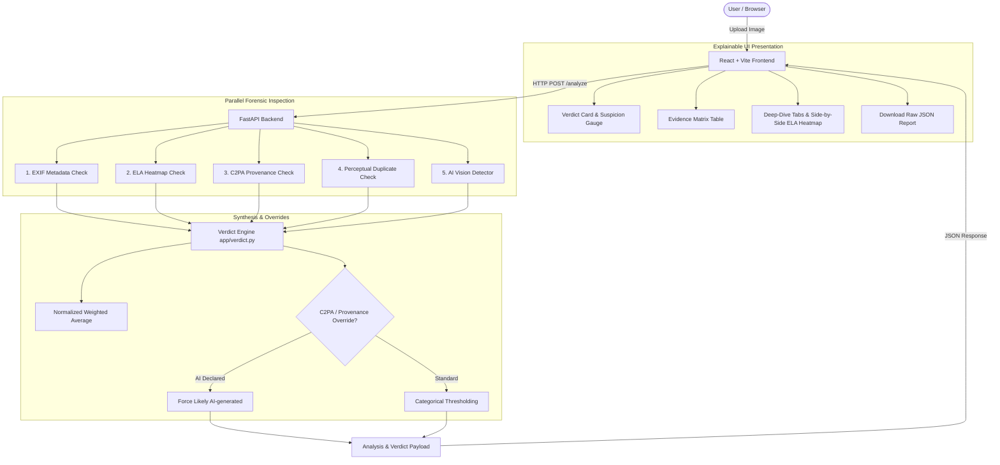

# Fake Media Detector

A production-grade, multi-vector digital forensics platform that analyzes digital images to detect AI synthesis, localized manipulation, out-of-context recycling, and provenance tampering.

---

## The Problem

The proliferation of photorealistic generative AI models (such as Midjourney, Flux, Stable Diffusion, and DALL-E) and accessible editing tools has made synthetic media indistinguishable from authentic photography to the human eye. 

In breaking news, legal proceedings, insurance claims, and social media moderation, manipulated or recycled imagery is frequently weaponized to mislead audiences, misattribute events, or spread disinformation. Relying on a single detection method is fragile: deep learning classifiers can be fooled by compression, metadata is routinely stripped by social media platforms, and compression artifacts can mimic tampering. A robust forensic platform must triangulate multiple independent physical, statistical, and cryptographic signals to provide nuanced, explainable verdicts.

---

## What It Does

The **Fake Media Detector** ingests an image and concurrently executes five specialized forensic checks before synthesizing an explainable verdict:

1. **Deep Learning AI Detector**: Evaluates pixel distributions using a Vision Transformer pipeline (`Organika/sdxl-detector`) to detect high-frequency diffusion synthesis artifacts and generative latent signatures.
2. **Error Level Analysis (ELA)**: Re-saves the image at a known JPEG compression quality level (90%) and analyzes amplified error differentials to surface localized splicing, compositing, and editing boundaries.
3. **C2PA Content Credentials Provenance**: Cryptographically validates embedded JUMBF provenance manifests to inspect signer certificates, editing history, and explicit machine-generated AI disclosures.
4. **Perceptual Duplicate Hash Matcher**: Computes 64-bit DCT perceptual hashes (pHash, aHash, dHash, wHash) and queries an indexed SQLite registry to flag recycled imagery and out-of-context reuse.
5. **EXIF & File Header Metadata**: Extracts camera hardware signatures, capture timestamps, GPS availability, and known editing/generative software signatures.

---

## How the Verdict Engine Works

Rather than outputting a brittle binary "fake" or "real" label, the verdict engine calculates a synthesized suspicion index ($0.0$ to $1.0$) using a normalized weighted average of available forensic signals:

### Base Check Weights

| Forensic Check | Base Weight | Target Anomaly |
| :--- | :---: | :--- |
| **AI Vision Detector** | `0.45` | Diffusion generation artifacts & synthetic pixel noise |
| **Error Level Analysis (ELA)** | `0.15` | Spliced regions & localized compression mismatches |
| **EXIF Metadata** | `0.15` | Editing software signatures (Photoshop, GIMP) & AI tags |
| **C2PA Content Credentials** | `0.15` | Cryptographic provenance & digital assertions |
| **Perceptual Duplicate Matcher** | `0.10` | Exact or near-duplicate recycling from reference database |

*Note: If any check is unavailable or errors out during execution, its weight is excluded and the remaining available weights are dynamically renormalized so their sum remains $1.0$.*

### Label Thresholds

- **`>= 0.65`** $\implies$ **`Likely AI-generated`** (`likely_ai_generated`)
- **`0.45 – 0.65`** $\implies$ **`Possibly Manipulated`** (`possibly_manipulated`)
- **`< 0.30`** $\implies$ **`Likely Authentic`** (`likely_authentic`)
- **Otherwise** $\implies$ **`Inconclusive`** (`inconclusive`)

### Override Rules

- **C2PA Generative AI Override**: If an image contains a cryptographically verified C2PA manifest explicitly declaring generative AI creation, the verdict immediately locks to **`Likely AI-generated`** with **`high`** confidence and suspicion score $\ge 0.95$, regardless of other scores.
- **C2PA Authentic Hardware Manifest**: If a valid, non-AI manifest from certified hardware or editing tools is detected, suspicion is reduced by $0.20$.
- **C2PA Tampered Manifest**: If manifest markers exist but cryptographic signature validation fails, suspicion is increased by $0.25$.
- **Duplicate Reuse Notice**: If a near-duplicate match is identified, a reason note is attached alerting investigators to potential media recycling.

---

## System Architecture



---

## Tech Stack

- **Backend API**: Python 3.11, [FastAPI](https://fastapi.tiangolo.com/), Uvicorn, Pydantic v2
- **Machine Learning / Vision**: [PyTorch](https://pytorch.org/) (CPU-optimized), [Hugging Face Transformers](https://huggingface.co/docs/transformers) (`Organika/sdxl-detector`), [Pillow](https://python-pillow.org/), [OpenCV](https://opencv.org/)
- **Forensic Utilities**: [ExifRead](https://github.com/ianare/exif-py), [c2pa-python](https://github.com/contentauth/c2pa-python), [ImageHash](https://github.com/JohannesBuchner/imagehash)
- **Database**: SQLite3 (embedded perceptual hash index)
- **Frontend Client**: React 19, [Vite](https://vite.dev/), [Tailwind CSS v4](https://tailwindcss.com/), [Lucide React](https://lucide.dev/)
- **Testing & Quality**: Pytest, Pytest-Cov (82% coverage), Scikit-Learn

---

## Getting Started

### 1. Prerequisites
- **Python**: 3.11 or higher
- **Node.js**: v18.0.0 or higher
- **Git**

### 2. Quick Start Scripts
- **Windows**:
  - Run `start_backend.bat` in one terminal window.
  - Run `start_frontend.bat` in a second terminal window.
- **Linux / macOS**:
  - Run `./start_backend.sh` in one terminal window.
  - Run `./start_frontend.sh` in a second terminal window.

---

### 3. Manual Step-by-Step Setup

#### Backend Setup
```bash
# Navigate to backend
cd backend

# Create and activate virtual environment
# Windows PowerShell:
python -m venv .venv
Set-ExecutionPolicy -ExecutionPolicy RemoteSigned -Scope Process
.\.venv\Scripts\Activate.ps1

# Linux / macOS:
python3 -m venv .venv
source .venv/bin/activate

# Install dependencies
pip install -r requirements.txt

# Start backend server
uvicorn app.main:app --reload --host 127.0.0.1 --port 8000
```
API Documentation will be live at:
- **Swagger UI**: [http://127.0.0.1:8000/docs](http://127.0.0.1:8000/docs)
- **Health Check**: [http://127.0.0.1:8000/health](http://127.0.0.1:8000/health)

#### Frontend Setup
```bash
# In a separate terminal, navigate to frontend
cd frontend

# Install Node dependencies
npm install

# Start Vite dev server
npm run dev
```
Open **`http://localhost:5173`** in your browser.

---

## Running Verification & Benchmark Scripts

### Automated Test Suite
```bash
cd backend
pytest -v
# Run with coverage report:
pytest --cov=app --cov-report=term-missing tests/
```

### Live End-to-End Smoke Test
```bash
cd backend
python scripts/smoke_test.py --url http://127.0.0.1:8000
```

### Robustness Degradation Test
```bash
cd backend
python scripts/robustness_test.py ../samples/ai_synthetic_sample.jpg
```

### AI Model Evaluation Benchmark
```bash
cd backend
python scripts/evaluate_detector.py --real-dir /path/to/real_images --ai-dir /path/to/ai_images
```

---

## Evaluation & Robustness Results

### Detector Benchmark Metrics *(fill in after running evaluate_detector.py)*

| Metric | Measured Score | Description |
| :--- | :---: | :--- |
| **Accuracy** | *[Pending Dataset]* | Overall fraction of correct classifications |
| **Precision** | *[Pending Dataset]* | Proportion of flagged images that are truly synthetic |
| **Recall** | *[Pending Dataset]* | Proportion of synthetic images successfully caught |
| **F1-Score** | *[Pending Dataset]* | Harmonic mean of precision and recall |
| **Dataset Size** | *[Pending Dataset]* | Total balanced evaluation images evaluated |

*Command to produce:*
```bash
python scripts/evaluate_detector.py --real-dir data/eval/real --ai-dir data/eval/ai --output data/eval_results.csv
```

### Robustness Under Real-World Degradation *(sample_ai.jpg)*

| Variant | Degradation Applied | AI Probability | ELA Score | Overall Score | Verdict Label |
| :--- | :--- | :---: | :---: | :---: | :--- |
| **Original** | None (Unmodified) | `0.997` | `0.118` | `0.950` | `likely_ai_generated` |
| **Resized 50%** | Bilinear downscale 50% | `1.000` | `0.016` | `0.630` | `possibly_manipulated` |
| **Resized 25%** | Bilinear downscale 25% | `0.296` | `0.088` | `0.324` | `inconclusive` |
| **JPEG Q70** | Recompressed quality 70 | `0.999` | `0.032` | `0.632` | `possibly_manipulated` |
| **JPEG Q30** | Aggressive compression Q30 | `1.000` | `0.030` | `0.632` | `possibly_manipulated` |
| **PNG Format** | Converted to lossless PNG | `0.997` | `0.118` | `0.644` | `possibly_manipulated` |
| **Screenshot** | Gaussian Blur + Resave | `0.999` | `0.021` | `0.630` | `possibly_manipulated` |
| **Center Crop** | 75% central bounding box | `1.000` | `0.013` | `0.629` | `possibly_manipulated` |

*Finding: The deep learning vision model retains strong detection stability (>0.99) across JPEG compression, screenshotting, format conversion, and 50% resizing. Extreme downsampling (25%) suppresses high-frequency latent artifacts, causing the verdict to correctly degrade to `inconclusive` rather than generating a confident false negative.*

---

## Known Limitations

1. **Generalization to Novel Architectures**: The pretrained Vision Transformer is trained primarily on Latent Diffusion (SDXL/Stable Diffusion) artifacts. Newer architectures (e.g. Flux, Midjourney v6, Sora) or novel fine-tunes may exhibit lower initial detection confidence until retrained.
2. **ELA on Non-JPEG Formats**: Error Level Analysis relies specifically on the discrete cosine transform (DCT) 8x8 block quantization error curve of the JPEG standard. ELA on native PNGs, uncompressed BMPs, or heavily re-saved screenshots produces flat error surfaces and must be treated as a weak signal.
3. **Platform Metadata Stripping**: Most consumer messaging apps (WhatsApp, Telegram, iMessage) and social networks (X, Instagram, Facebook) strip EXIF and C2PA containers on upload. The absence of metadata or C2PA credentials is never treated as proof of forgery.
4. **Local Perceptual Database Scope**: The duplicate check queries only references registered in its local SQLite database; it is not connected to global reverse-image search engines (such as Google Images or TinEye).
5. **Static Images Only**: Current analysis pipeline supports raster images (`.jpg`, `.jpeg`, `.png`, `.webp`). Video and audio deepfakes are outside the scope of Phase 1–5.
6. **Probabilistic Heuristics**: All outputs are calibrated probabilistic estimates and technical indicators, not definitive legal proof of manipulation.

---

## Future Roadmap

- [ ] **Temporal Video Forensics**: Frame-sampling pipeline with optical flow analysis and audio-visual synchronization checks for deepfake videos.
- [ ] **Audio Deepfake Detection**: Spectrogram-based transformer models to detect synthesized voice cloning.
- [ ] **Learned Meta-Classifier Weights**: Train a calibrated Logistic Regression / XGBoost model on balanced ground-truth datasets to learn optimal check weights dynamically.
- [ ] **Chromium Browser Extension**: Right-click inspection tool enabling journalists and fact-checkers to analyze web imagery directly in-browser.
- [ ] **Invisible Watermark Verification**: Integrate SynthID and Adobe Content Authenticity digital watermark decoders.

---

## Screenshots

*(Placeholders for UI showcase images)*

| Drag-and-Drop Analysis Workspace | Explainable Verdict Card & Suspicion Index |
| :---: | :---: |
| *[Screenshot: UploadBox & Navbar]* | *[Screenshot: VerdictCard & Confidence]* |

| Multi-Vector Evidence Matrix Table | Side-by-Side ELA Heatmap Comparison |
| :---: | :---: |
| *[Screenshot: EvidenceTable]* | *[Screenshot: Original vs Heatmap]* |

---

## License

This project is released under the **MIT License**.
